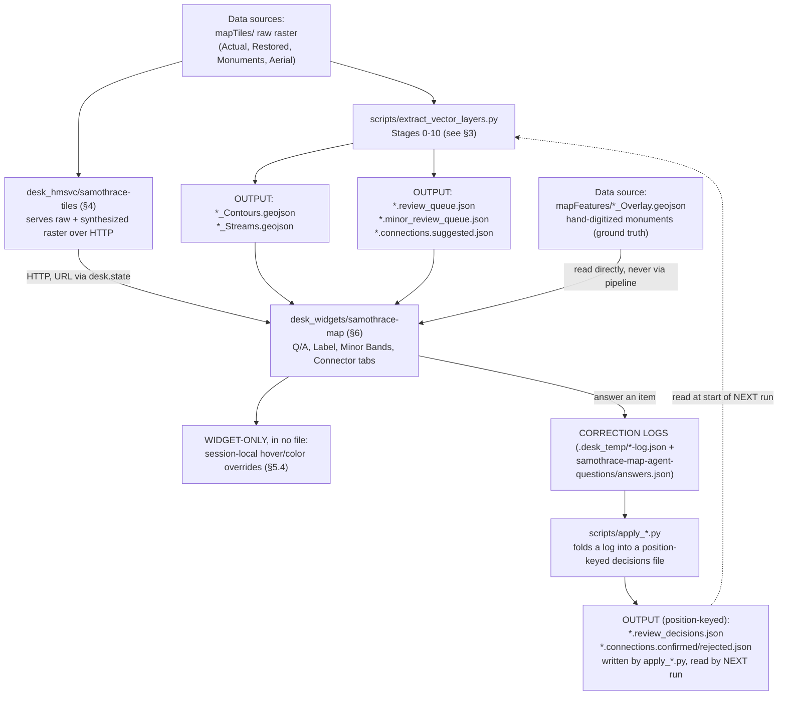
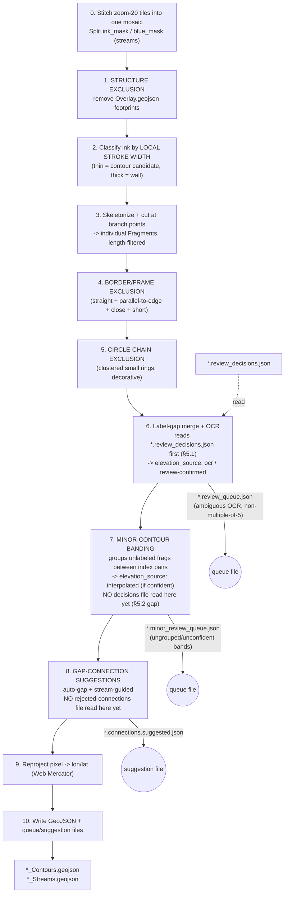
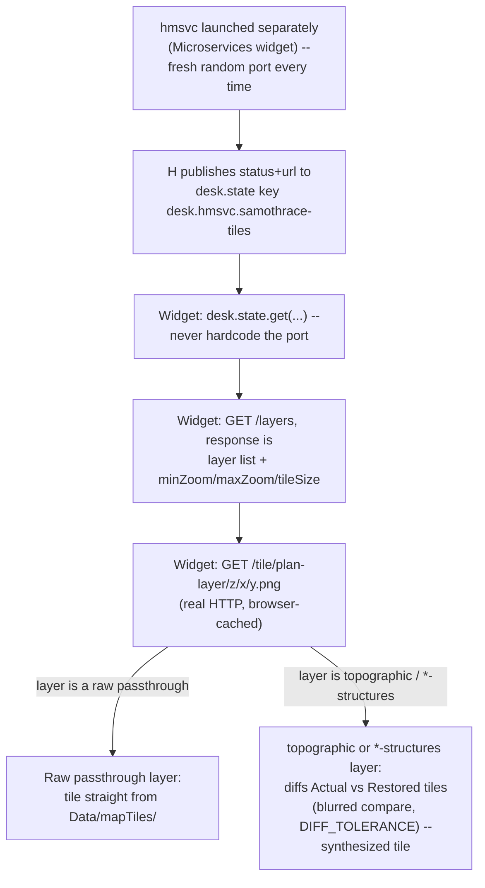
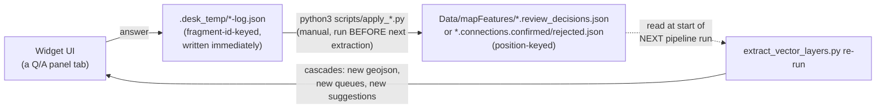
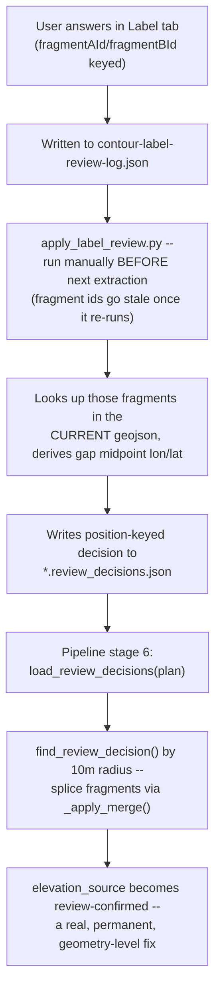
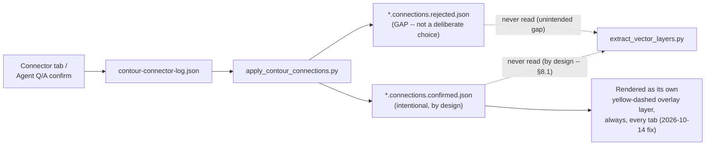
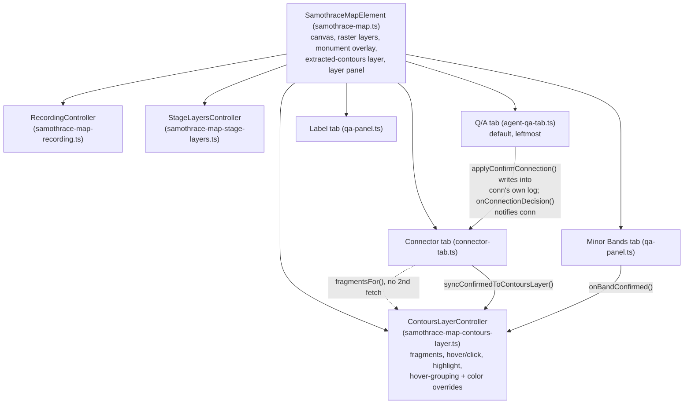

# Samothrace data flow & correction-loop architecture

Living reference, not a plan — written 2026-10-15 so we have a shared
map to point at ("the thing at stage 6", "the Minor Bands leg of the
correction loop") instead of re-describing the system in prose every
time. Update it as the architecture changes; don't let it go stale the
way a one-off plan doc is allowed to.

This covers the **current, real state of the system**, including the
gaps and deliberate design choices that make some correction types feed
back into a pipeline re-run today and others don't yet. §8 at the end
collects the open questions this raised — that's the part actually worth
discussing, the rest is just grounding.

## 1. System overview

The loop that matters: **pipeline output → widget shows it → human/agent
corrects something → correction lands in a log → an apply script folds
it into a position-keyed decisions file → the *next* pipeline run reads
that file and bakes the correction into real geometry**, which then
flows back through the whole system again (new queues, new suggestions,
new colors) with no further manual patching needed. §5 shows exactly
which correction types currently complete that loop and which don't.

## 2. Data sources

| Path | What it is | Who reads it |
|---|---|---|
| `Data/mapTiles/SamoWebsite_{ActualStatePlan,RestoredStatePlan,ActualStateMonuments,RestoredStateMonuments,AerialImagery}_3857/` | Raw pre-tiled raster, zoom 17-22, Web Mercator | `samothrace-tiles` hmsvc (serves + synthesizes from these); `extract_vector_layers.py` (stitches zoom-20 tiles into one mosaic per plan) |
| `Data/mapFeatures/SamoWeb_{Actual,Restored}StatePlan_Overlay.geojson` | Hand-digitized monument footprint polygons — **ground truth, predates the extraction pipeline, never regenerated by it** | SamothraceMap widget directly (monument hover/click/dropdown); `extract_vector_layers.py`'s structure-exclusion stage (buffers and removes this ink before contour extraction) |
| `Data/mapCode/`, `Data/mapDescriptions/`, `Data/mapIcons/` | The forked original website's own JS/CSS/text/image assets (see root `README.md`) | Not read by the live Desk system at all today — reference/historical only, kept for monument description text provenance |

## 3. Extraction pipeline — `scripts/extract_vector_layers.py`

Runs both plans independently (no cross-plan diffing), one Python
process, currently invoked **manually** (`python3
scripts/extract_vector_layers.py`, optionally `GAP_DEBUG=1` — see §3.1)
— not yet wrapped as a Desk Job of any kind (see §7). Real recent
timing: **~12 seconds** for both plans end to end, OCR included.

Stages 1, 4, 5 are **exclusion** passes (remove non-terrain ink); the
widget's "Pipeline (Actual/Restored)" debug layers (`00`–`06` in the
layer panel) are PNG snapshots of a subset of these stages — mapping:
PNG `00`=stage 0, `01`=stage 1, `02`=stages 2+3 combined ("candidate
fragments"), `03`=stage 4, `04`=stage 5, `05`=stage 6, `06`=stage 7.
Stages 8-10 have no PNG (nothing mask-shaped to show).

**Known, documented instability**: fragment ids are array positions in
that run's own output — they shift across re-runs. Every correction
file this project writes is therefore **position-keyed (lon/lat)**, not
fragment-id-keyed, with one deliberate exception (§5.1's translation
step) — see the module's own "Known limitations" docstring section.

### 3.1 `GAP_DEBUG=1` instrumentation

Added this session for root-causing why specific gap-connections weren't
suggested. When set, stage 8 additionally writes
`*_Contours.gap_debug.json`: **every** candidate endpoint pair it
considered (not just the ones that passed), with distance, both turn
angles, and a `rejectReason` (`elev-diff` / `zero-length-gap` /
`turn-angle` / none). Diagnostic only — never read back by anything,
purely for an agent investigating a specific "why wasn't X suggested"
question.

## 4. `samothrace-tiles` hmsvc

The widget's own "Extracted contours" layer is **not** served by hmsvc
at all — that's vector data, read directly via the `fs` capability
(`desk.fs.readFile` on the `*.geojson`), drawn on the canvas.

## 5. Per-item correction loop

The shape every correction type is *supposed* to follow:

**Four correction types exist. Only one closes this loop completely
today:**

| Correction type | Widget tab | Session log | Apply script | Position-keyed output | Read back by pipeline? |
|---|---|---|---|---|---|
| OCR label review | Label | `contour-label-review-log.json` | `apply_label_review.py` ✅ exists | `*.review_decisions.json` | ✅ **yes** — stage 6, splices the two fragments into one labeled `Fragment` |
| Minor-band confirmation | Minor Bands | `minor-contour-review-log.json` | `apply_minor_review.py` ❌ **doesn't exist** | — none | ❌ no (stage 7 has no decisions-reading equivalent at all) |
| Gap-connection confirm/reject | Connector + Agent Q&A | `contour-connector-log.json` | `apply_contour_connections.py` ✅ exists | `*.connections.{confirmed,rejected}.json` | ❌ **deliberately not** — confirmed connections are kept as a permanent, separate overlay, never spliced into "real" geometry (see §8.1); rejections aren't consumed either (noted gap in that script's own docstring) |
| Agent-posed question (`confirm-connection`) | Q/A | *(writes directly into the Connector's own log + a generic `samothrace-map-agent-{questions,answers}.json` pair)* | *(same as Connections, above)* | *(same as Connections, above)* | *(same as Connections, above)* |

### 5.1 Label review — the one closed loop (reference pattern)

### 5.2 Minor bands — half-built (log exists, nothing consumes it)

This session's real example: fragments `35`+`103` (Restored, confirmed
connected) plus `36`/`37`/`38` turned out to be exactly the 4
well-separated contours stage 7 looks for between two index lines —
but stage 7 has no `load_minor_band_decisions()`-equivalent to ever
notice that. The fix applied was entirely **session-local** (see §5.4),
not a pipeline fix: I hand-derived the grouping/ordering from real
geometry, wrote a `MinorBandGroupAnswer` directly into
`minor-contour-review-log.json` (correct schema, ready for whenever the
apply script exists), and separately told the live widget to render
amber via an in-memory override. **If Desk restarts or the widget
reloads from a fresh process with no override replay, the color reverts
to grey** — only the log entry is durable; nothing yet turns it into a
real fix.

### 5.3 Gap connections — intentionally one-way (so far)

This one is a **deliberate design choice**, not an oversight — the
Connector tab's own file header is explicit: a confirmed connection is
"a judgment call about where a line probably continues," categorically
different from what the source plan actually shows, and "conflating the
two would make it impossible to later tell which is which." Rejections
not being consumed is a genuine gap (the pipeline will keep re-suggesting
something a human already dismissed), separate from the confirmed-side
choice. See §8.1 — this is exactly the design tension your message
raised.

### 5.4 Session-local widget overrides — the pattern to retire

Two mechanisms, both added this session, both **pure in-memory state on
the live `SamothraceMapElement`, in no file anywhere**:

- `ContoursLayerController.setConfirmedConnections` → union-find grouping
  so hovering either half of a confirmed connection highlights both as
  one contour.
- `ContoursLayerController.setFragmentElevationOverrides` /
  `effectiveColorFor` → forces the amber "minor" color for fragments
  confirmed via Minor Bands.

Both exist **because** the real fix (§5.2, §8.1) isn't wired up yet —
they're a stand-in for "what the UI would look like after the next
pipeline re-run," not a replacement for actually re-running it. They
vanish on reload; they never change what a pipeline re-run would
produce; two different session instances of the widget would disagree
with each other. This is the exact pattern your message is asking to
move away from — see §8.2.

## 6. Widget internals — `desk_widgets/samothrace-map/`

One instance of `ContoursLayerController` is the single source of truth
for fragment geometry — every other controller that needs fragments
(Connector tab, formerly also the Agent Q&A tab's highlight) goes
through it (`fragmentsFor`) rather than re-fetching the same `*.geojson`.

### Known remaining gaps (full detail in `desk_widgets/samothrace-map/TODO.md`)

- Recording-log answers aren't also written durably (lost if Desk
  restarts mid-recording).
- Layer visibility / zoom don't persist across a widget reload.
- Monument hover and the Connector tab's own hover still don't log to
  the recording (only contour hover does).
- Agent Q&A tab has exactly one question type; delivery is 4s-polled
  file pair, no push, no read-confirmation (see
  `FEEDBACK-DESK-agent-qa-file-polling-2026-10-13-1845.md`).

## 7. Automation / Jobs landscape

Today: **nothing about this pipeline is wrapped as a Desk Job of any
kind.** Every pipeline run this session was a plain `Bash` invocation
(`python3 scripts/extract_vector_layers.py`, optionally
`GAP_DEBUG=1 ...`), run manually by an agent, against the **whole**
mosaic for **both** plans every time (~12s — fast enough that this has
never been a real problem in practice).

Desk's own tempui mechanisms that exist and could apply here (see
`.desk_temp/tempui-*.md` for full detail on each):

| Mechanism | Shape | Fit for this pipeline |
|---|---|---|
| `Job` / `DeskProc` | One-shot tempui file-drop, needs a fresh file + a human click every time | Current manual Bash invocation is simpler for a full re-run; not worth wrapping as-is |
| **Installed Job** | Approved once, then callable repeatedly via `desk_run_installed_job` with no further human click | The natural fit for "re-run after a correction" if this becomes frequent enough to want zero-click re-runs |

`plans/incremental-pipeline-runs.md` (deferred, no action item) already
discussed exactly this: wrap a **region-scoped** version of the pipeline
(bounding box in, processes just that crop) as an Installed Job, so an
agent could re-run extraction on just the area just discussed within the
same conversation turn. That plan explicitly decided **against**
building incremental/cached staging up front — measure first, the
counter-proposal was. Given this session's real ~12s full-pipeline
timing, there may be even less pressure toward region-scoping than that
doc assumed when it was written — worth revisiting with that number in
hand (see §8.3).

## 8. Open questions — for us to actually discuss

### 8.1 Should confirmed connections ever get spliced into real geometry?

Right now this is a **deliberate** no (§5.3) — a judgment call kept
permanently distinguishable from "what the plan actually shows."
Reversing that would mean: on a pipeline re-run, a confirmed connection
could actually merge its two fragments into one `Fragment` (like label
review already does), which would let stage 7 (minor-banding) and stage
8 (gap-suggestions) see the corrected topology too — exactly the
"cascading changes" your message described wanting. Trade-off: losing
the current hard guarantee that extracted geometry only ever reflects
"what was actually drawn," not an inference.

### 8.2 Retire session-local overrides once this loop is fast?

Given §7's ~12s real pipeline timing, the honest question: do we even
need session-local color/hover-grouping overrides (§5.4) as a permanent
feature, or were they only ever a reasonable stand-in for *this session*
because landing a real pipeline-level fix took real investigation time?
If re-running the pipeline is cheap and the corrections it needs to read
(§5.1's pattern, extended to minor bands and — pending 8.1 — connections)
are all wired up, "confirm a correction → re-run → see the real result"
could fully replace "confirm a correction → see a session-local patch
that's secretly still wrong until someone remembers to also fix the
pipeline."

### 8.3 Write `apply_minor_review.py` + the stage-7 read-back it needs

The concrete, smallest next step toward closing §5.2's gap: a script
mirroring `apply_label_review.py`'s shape (translate fragment-id-keyed
answers into a position-keyed `*.minor_band_decisions.json`), **plus**
giving `band_minor_contours` (stage 7) the read-back logic stage 6
already has for label decisions. Worth doing even before resolving 8.1,
since it's unambiguously a gap (not a deliberate choice) and the
35/103/36/37/38 case this session is a ready-made real test fixture for
it.

### 8.4 Region-scoped / Installed-Job re-runs, now with a real number

`plans/incremental-pipeline-runs.md` deferred this pending "does a full
re-run feel slow in practice" — it doesn't, at ~12s. Does that settle
it (don't build region-scoping, a full re-run is already cheap enough to
be the default "apply a correction" action), or is there a reason to
still want a zero-click Installed Job wrapper regardless of raw speed
(e.g. not wanting to shell out to Bash from an agent turn, or wanting
this runnable by someone without repo/terminal access)?
